<!--
SEO keywords: Death Legion Team, Death Legion Sri Lanka, deathlegionteamlk, Sri Lankan developers,
Sri Lanka software engineers, open source Sri Lanka, AI agents, autonomous coding agent, LLM agent framework,
computer-use agent, local LLM inference, self-hosted AI assistant, OS kernel development, custom kernel,
Brainfuck kernel, Idris kernel, operating systems from scratch, game server control panel, Pterodactyl alternative,
Docker game panel, Android emulator, Android keyboard app, Sinhala keyboard, Windows Subsystem for Android,
programming language design, concurrent programming language, distributed NoSQL database, Firebase alternative,
Postgres backend, workflow automation platform, Zapier alternative, Chromium browser fork, AI browser,
coding benchmark, agentic AI benchmark, penetration testing automation, deepfake detection, real-time face tracking,
full-stack development team, TypeScript React projects, Next.js FastAPI notebook, GitHub organization portfolio,
open source contributors Sri Lanka, indie dev collective, hacker collective Sri Lanka

The typing effects, terminals, ticker, glitch banner and 3D wireframes below are SVG files in ./assets, and the
GIFs are in the same folder. GitHub won't render base64 images in a README, so they're plain files. Nothing calls an
outside typing service, so nothing breaks when somebody else's API goes down. gen.py and gifs.py rebuild all of it.
-->

<a href="https://github.com/deathlegionteamlk">
  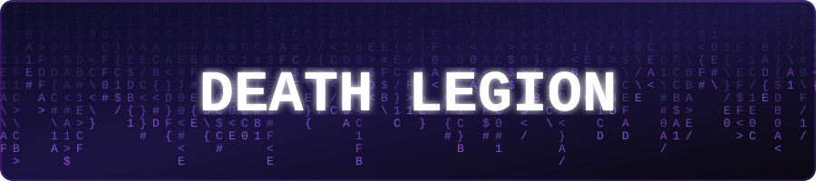
</a>

 

 

  

  

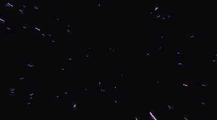

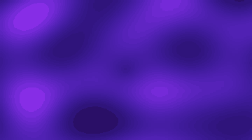

 

 

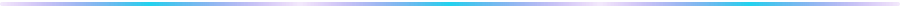

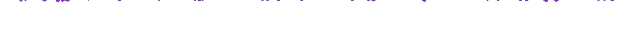

 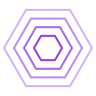 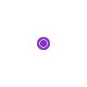  

##  Who we are

We're a small crew in Sri Lanka. The org name is closer to how we work than any mission statement would be. One week it's an OS kernel, the next week somebody decides to write a browser. There's no roadmap because none of us knows what we'll be into next month.

Plenty of this is half documented and rough. Building the thing is more fun than writing the README for it, so the README loses. If a repo looks unfinished, it probably is. We either come back to it or we don't, and something new usually turns up first.

Looking for Sri Lankan developers on GitHub, open source AI agents, custom kernels, game server panels, or a dev collective from Sri Lanka? You're in the right place.

  


 

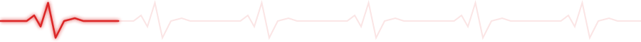

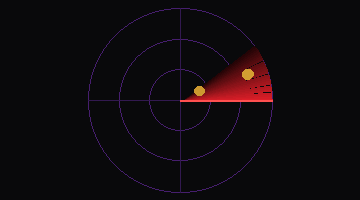
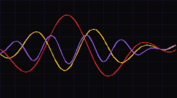
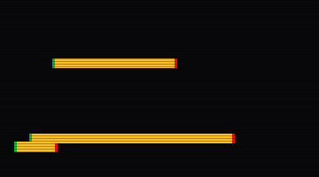

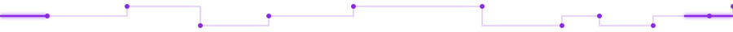

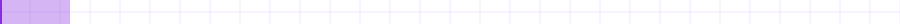

   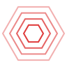 

##  Stack

Nobody picked a stack for this org. Each repo used whatever fit at the time, and after 52 of those the list looks less like a plan and more like a confession.

<a href="https://deathlegion.netlify.app/3d/">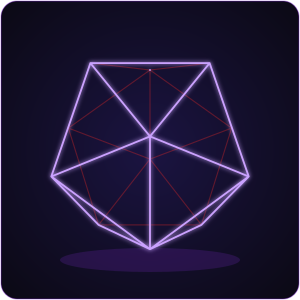</a>

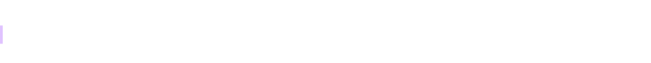


**Languages**

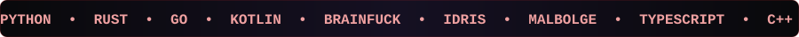

**Esoteric languages**

The Brainfuck kernel wasn't a one-off. If it's on the [esolang wiki](https://esolangs.org), someone here has probably opened a terminal for it and regretted it.

**Frontend & UI**

**Backend & frameworks**


**Mobile**

**Databases & storage**

**DevOps, cloud & infra**

**AI / ML**

**Systems & low-level**


**Editors & tools**

 

If we haven't touched a language or framework yet, give it a month. Somebody has a half-finished branch for it on a laptop that needs a restart.

 

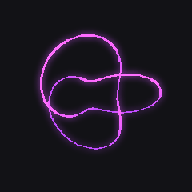

    

##  AI agents & autonomous tools

| Project | What it does |
|---|---|
| [deathlegion-benchmark](https://github.com/deathlegionteamlk/deathlegion-benchmark) | A coding benchmark that doesn't go easy on you. Algorithmic, agentic and adversarial categories. |
| [Fraction](https://github.com/deathlegionteamlk/Fraction) | A computer-use agent that drives a real desktop instead of calling stubbed tools. |
| [herolaw](https://github.com/deathlegionteamlk/herolaw) | A private, fully local AI assistant with OpenClaw-style features. Lobster-themed, and we stand by that. |
| [herodesktop](https://github.com/deathlegionteamlk/herodesktop) | A streamable, sandboxed virtual desktop so agents can click around without breaking anything real. |
| [legion-code](https://github.com/deathlegionteamlk/legion-code) | An autonomous coding agent framework. The safety rails are off on purpose. |
| [legionhbt](https://github.com/deathlegionteamlk/legionhbt) | An autonomous pentesting setup. Point it at a target and it works through the checklist. |
| [legion-coder-v1](https://github.com/deathlegionteamlk/legion-coder-v1) | An AI code editor. Completion, refactors and project scaffolding in one agent loop. |
| [legiontret](https://github.com/deathlegionteamlk/legiontret) | Runs 30+ open models locally, including Llama 3, Gemma 3, Mistral and DeepSeek R1. No GPU rental. |
| [DeepFaceReal-Physics](https://github.com/deathlegionteamlk/DeepFaceReal-Physics) | Real-time deepfake detection with full body tracking, physics sim, parallax backgrounds and an LLM that talks back. |
| [LEGIONGASPER](https://github.com/deathlegionteamlk/LEGIONGASPER) | Early agent tooling. Still figuring out what it wants to be. |

 


 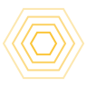   

##  Security & offensive tooling

| Project | What it does |
|---|---|
| [leorch](https://github.com/deathlegionteamlk/leorch) | A Rust CLI for people who'd rather script than click. 7 stars so far. |
| [legionrat](https://github.com/deathlegionteamlk/legionrat) | A consent-based Android remote admin tool for lab devices you own. |
| [Brainfuck-OS-kernel](https://github.com/deathlegionteamlk/Brainfuck-OS-kernel) | An OS kernel in Brainfuck. Someone had to. |
| [Herobine_wa](https://github.com/deathlegionteamlk/Herobine_wa) | A Go utility that works on our machines. |

 

   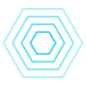 

##  OS, kernels & low-level

| Project | What it does |
|---|---|
| [Herojuk](https://github.com/deathlegionteamlk/Herojuk) | Our favorite kernel so far. We'll say it ourselves since nobody else will. |
| [LegionBFOS](https://github.com/deathlegionteamlk/LegionBFOS) | A C-based OS project, sibling to the Brainfuck kernel. |
| [legion-idris-kernel](https://github.com/deathlegionteamlk/legion-idris-kernel) | A kernel written in Idris, for the dependently typed. |
| [LEGION-dns-tunnel](https://github.com/deathlegionteamlk/LEGION-dns-tunnel) | A simple DNS-based VPN tunnel in Kotlin. |

 

    

##  Dev tools & frameworks

| Project | What it does |
|---|---|
| [legionrtya](https://github.com/deathlegionteamlk/legionrtya) | A declarative JS library for building UIs. Our answer to React. |
| [heroch](https://github.com/deathlegionteamlk/heroch) | A high-performance deep learning library written from scratch in Python. |
| [heroflow](https://github.com/deathlegionteamlk/heroflow) | A machine learning framework in C++ for when Python is too slow. |
| [herio](https://github.com/deathlegionteamlk/herio) | A small Python library that turns any function or model into a web UI. |
| [herodb](https://github.com/deathlegionteamlk/herodb) | A distributed NoSQL document store written from scratch in C++. It actually shards. |
| [herobase](https://github.com/deathlegionteamlk/herobase) | An open-source Firebase alternative on Postgres. |
| [herokil](https://github.com/deathlegionteamlk/herokil) | A lightweight Python web framework. Easy enough for a first project, flexible enough to keep using. |
| [urmom-lang](https://github.com/deathlegionteamlk/urmom-lang) | A modern concurrent programming language. Yes, that's the name. No, we're not renaming it. |
| [legionnative](https://github.com/deathlegionteamlk/legionnative) | A TypeScript tooling project, still early. |
| [legionheto](https://github.com/deathlegionteamlk/legionheto) | A Python utility. Light on docs. |
| [LEGIONHERCULES](https://github.com/deathlegionteamlk/LEGIONHERCULES) | Live at [legionhercules.pages.dev](https://legionhercules.pages.dev). Python backend, still changing. |


 

 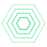   

##  Android & mobile

| Project | What it does |
|---|---|
| [LiyoBoard](https://github.com/deathlegionteamlk/LiyoBoard) | A privacy-first Android keyboard with Sinhala, English and Tamil, 500+ fonts and deep theming. |
| [Legion-K-Player](https://github.com/deathlegionteamlk/Legion-K-Player) | A fast Android emulator with 100+ gaming modules and a custom VM core. |
| [uytr](https://github.com/deathlegionteamlk/uytr) | A custom Windows Subsystem for Android package builder with Magisk root and Play Services, packaged as a Windows installer. |
| [legion-mobile-sandbox](https://github.com/deathlegionteamlk/legion-mobile-sandbox) | A Jupyter sandbox for testing mobile-adjacent workflows. |

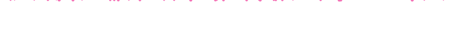

 

 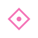  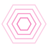 

##  Game server panels

| Project | What it does |
|---|---|
| [legiondactyl-clean](https://github.com/deathlegionteamlk/legiondactyl-clean) | A game server panel with Docker isolation and real-time monitoring. |
| [demoxhexadctyl](https://github.com/deathlegionteamlk/demoxhexadctyl) | A web-based game server panel in PHP. |
| [ptredactyl-installer](https://github.com/deathlegionteamlk/ptredactyl-installer) | A shell installer that gets a panel stack running without the manual setup. |
| [Legion-uytr](https://github.com/deathlegionteamlk/Legion-uytr) | A TypeScript companion project for the same panel ecosystem. |

 

    

##  Web platforms & automation

| Project | What it does |
|---|---|
| [legion-hutta](https://github.com/deathlegionteamlk/legion-hutta) | A language-agnostic web notebook. Next.js 16 and React 19 up front, FastAPI behind. |
| [dliy-io](https://github.com/deathlegionteamlk/dliy-io) | A self-hostable workflow automation platform. Zapier without the bill. |
| [doodle](https://github.com/deathlegionteamlk/doodle) | An open-source LMS with a built-in AI assistant. PHP 8+. |
| [legion-hyt-js](https://github.com/deathlegionteamlk/legion-hyt-js) | A TypeScript web utility from the wider Legion tooling set. |
| [HeroBrowser](https://github.com/deathlegionteamlk/HeroBrowser) | A Chromium-based browser with AI features and an Opera GX-inspired UI. |

 

 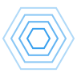   

##  Community, meta & fun stuff

| Project | What it does |
|---|---|
| [awesome-srilankan-devs](https://github.com/deathlegionteamlk/awesome-srilankan-devs) | A curated list of tools, projects and people from Sri Lankan developers. |
| [awesome](https://github.com/deathlegionteamlk/awesome) | Our fork of sindresorhus/awesome, kept for reference. |
| [gh-achievements](https://github.com/deathlegionteamlk/gh-achievements) | A small project for tracking GitHub achievement badges. |
| [contribution-graph-art](https://github.com/deathlegionteamlk/contribution-graph-art) | Turns the contribution graph into art, one commit at a time. |
| [badge-collector](https://github.com/deathlegionteamlk/badge-collector) | A GitHub badge collector script. |
| [badge-collector-2](https://github.com/deathlegionteamlk/badge-collector-2) | Round two of the badge collector, cleaned up. |
| [developer-portfolio-template](https://github.com/deathlegionteamlk/developer-portfolio-template) | A clean dark portfolio template in React, TypeScript, Tailwind and Vite, for students and early-career devs. |
| [srilankan-horror-mod](https://github.com/deathlegionteamlk/srilankan-horror-mod) | A Minecraft Forge 1.20.1 mod drawn from Sri Lankan demonology. 8 demons, jumpscares, a sanity system and 45 custom sounds. |
| [LANKA-Night-terror](https://github.com/deathlegionteamlk/LANKA-Night-terror) | Early stage. Description pending. |
| [deathlegionteamlk](https://github.com/deathlegionteamlk/deathlegionteamlk) | This org's profile repo, the one rendering this page. |

 

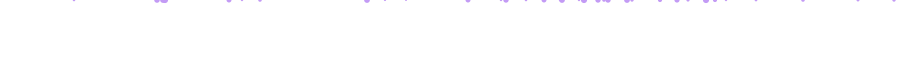

  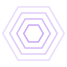 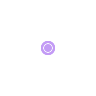 

##  Activity

We're not chasing metrics. The numbers are here if you want them:

 

  

 

 

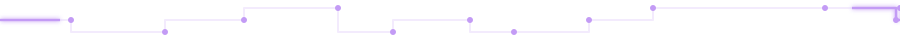

**52 public repos and counting. We build what we're curious about, ship it, and move on.**


