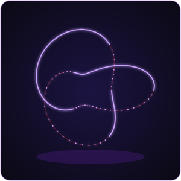
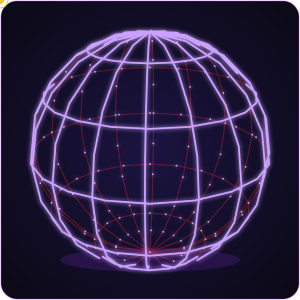

<!--
SEO keywords: Death Legion Team, Death Legion Sri Lanka, deathlegionteamlk, Sri Lankan developers,
Sri Lanka software engineers, open source Sri Lanka, AI agents, autonomous coding agent, LLM agent framework,
computer-use agent, local LLM inference, self-hosted AI assistant, OS kernel development, custom kernel,
Brainfuck kernel, Idris kernel, operating systems from scratch, game server control panel, Pterodactyl alternative,
Docker game panel, Android emulator, Android keyboard app, Sinhala keyboard, Windows Subsystem for Android,
programming language design, concurrent programming language, distributed NoSQL database, Firebase alternative,
Postgres backend, workflow automation platform, Zapier alternative, Chromium browser fork, AI browser,
coding benchmark, agentic AI benchmark, penetration testing automation, deepfake detection, real-time face tracking,
full-stack development team, TypeScript React projects, Next.js FastAPI notebook, GitHub organization portfolio,
open source contributors Sri Lanka, indie dev collective, hacker collective Sri Lanka,
animated GitHub profile README, interactive 3D model, three.js, rotating wireframe, SVG animation, SMIL

All the typing effects, terminal windows, tickers, counters, orbits, glitch banner and the rotating 3D wireframes
below are hand-generated SVGs living in ./assets (see assets/ and gen.py). GitHub does not render base64 data: URIs
in README images, so they are real files referenced by relative path: no external typing-service API, nothing that
can silently 404 on you six months from now. SVG animation (SMIL/CSS) runs inside  on GitHub; JavaScript does
not, which is why the truly interactive 3D scene is a separate page in /docs/3d that you host (Netlify / GitHub Pages)
and link from here.
-->

 

 

  

  

  

 

##  Who we are

We're a small crew out of Sri Lanka, and honestly the org name is more accurate to how we work than most mission statements would be. Some weeks it's an OS kernel. Some weeks someone gets it in their head to write a browser. There's no roadmap because a roadmap assumes we know next month what we'll be curious about, and we don't.

A lot of what's in here is half-documented and a little rough around the edges. That's not an oversight, it's just what happens when the fun part (building the thing) always wins out over the less fun part (writing the README for the thing). If a repo looks unfinished, it probably is — we get back to it eventually, or we don't, and something new usually shows up before the old thing gets closed out either way.

If you landed here looking for **Sri Lankan developers on GitHub**, **open source AI agents**, **custom OS kernels**, **game server panels**, or a **Sri Lanka-based dev collective** in general — you're in the right place.

  

 

##  The Legion in 3D

Three real rotating wireframes, projected frame by frame (front edges bright, back edges dim), no JavaScript, no GIF. Pure SVG animation, so they stay sharp at any size and weigh next to nothing.

 

drag to orbit, scroll to zoom, click a node to jump to its repo (source in <a href="./docs/3d/index.html"><code>docs/3d</code></a>)

  

##  Stack we actually touch (and a lot we've at least poked at)

Nobody sat down and picked one stack for this org. Each repo just grabbed whatever tool made sense at the time it got started, and after 52 of those decisions the combined list stops looking like a plan and starts looking like a confession.

**Languages**

**Esoteric & "why does this exist" languages**

The Brainfuck kernel wasn't a one-off, it was a warning sign. If it's on the [esolang wiki](https://esolangs.org), someone here has opened a terminal for it and lived to regret it.

**Frontend & UI**

**Backend & frameworks**

**Mobile**

**Databases & storage**

**DevOps, cloud & infra**

**AI / ML**

**Systems & low-level**

**Editors, shells & everyday tools**

 

If it's a language, framework, or runtime and we haven't touched it yet — give it a month. Someone on the team almost certainly has a half-finished branch for it sitting somewhere, uncommitted, on a laptop that needs a restart.

 

##  AI agents & autonomous tools

| Project | What it does |
|---|---|
| [deathlegion-benchmark](https://github.com/deathlegionteamlk/deathlegion-benchmark) | One of the harder coding benchmarks out there. Algorithmic, agentic, adversarial categories — no easy mode. |
| [Fraction](https://github.com/deathlegionteamlk/Fraction) | A computer-use agent that drives a real desktop instead of calling stubbed-out tools. |
| [herolaw](https://github.com/deathlegionteamlk/herolaw) | A private, fully local AI assistant with OpenClaw-style features. Lobster-themed, and we stand by that. |
| [herodesktop](https://github.com/deathlegionteamlk/herodesktop) | A streamable, sandboxed virtual desktop, built so agents have somewhere safe to click around without breaking anything real. |
| [legion-code](https://github.com/deathlegionteamlk/legion-code) | An autonomous coding agent framework with the safety rails taken off on purpose. |
| [legionhbt](https://github.com/deathlegionteamlk/legionhbt) | An autonomous pentesting ecosystem. Point it at a target and it works through the checklist. |
| [legion-coder-v1](https://github.com/deathlegionteamlk/legion-coder-v1) | An AI-powered code editor — completion, refactors, full project scaffolding, all in one agent loop. |
| [legiontret](https://github.com/deathlegionteamlk/legiontret) | Runs 30+ open models locally: Llama 3, Gemma 3, Mistral, DeepSeek R1. No GPU rental required. |
| [DeepFaceReal-Physics](https://github.com/deathlegionteamlk/DeepFaceReal-Physics) | Real-time deepfake detection with full body tracking, physics sim, parallax backgrounds, and an LLM that talks back. |
| [LEGIONGASPER](https://github.com/deathlegionteamlk/LEGIONGASPER) | Early-stage agent tooling. Still figuring out what it wants to be when it grows up. |

 

##  Security & offensive tooling

| Project | What it does |
|---|---|
| [leorch](https://github.com/deathlegionteamlk/leorch) | A Rust CLI for people who'd rather script than click. 7 stars in and counting. |
| [legionrat](https://github.com/deathlegionteamlk/legionrat) | A consent-based Android remote admin tool. Lab devices you own, full stop. |
| [Brainfuck-OS-kernel](https://github.com/deathlegionteamlk/Brainfuck-OS-kernel) | An OS kernel written in Brainfuck. Someone had to. |
| [Herobine_wa](https://github.com/deathlegionteamlk/Herobine_wa) | A Go utility, still very much in the "works on our machine" phase. |

 

##  OS, kernels & low-level

| Project | What it does |
|---|---|
| [Herojuk](https://github.com/deathlegionteamlk/Herojuk) | Our favorite kernel we've built so far. We'll say it ourselves since no one else is going to. |
| [LegionBFOS](https://github.com/deathlegionteamlk/LegionBFOS) | A C-based OS project, sibling to the Brainfuck kernel above. |
| [legion-idris-kernel](https://github.com/deathlegionteamlk/legion-idris-kernel) | A kernel written in Idris, for the dependently-typed among us. |
| [LEGION-dns-tunnel](https://github.com/deathlegionteamlk/LEGION-dns-tunnel) | A simple DNS-powered VPN tunnel, written in Kotlin. |

 

##  Dev tools & frameworks

| Project | What it does |
|---|---|
| [legionrtya](https://github.com/deathlegionteamlk/legionrtya) | A declarative JS library for building UIs. Our answer to React. |
| [heroch](https://github.com/deathlegionteamlk/heroch) | A high-performance deep learning library, built from the ground up in Python. |
| [heroflow](https://github.com/deathlegionteamlk/heroflow) | A machine learning framework in C++, for when Python gets in the way of speed. |
| [herio](https://github.com/deathlegionteamlk/herio) | A lightweight Python library that turns any function or model into an instant web UI. |
| [herodb](https://github.com/deathlegionteamlk/herodb) | A distributed NoSQL document store, written from scratch in C++, built to actually shard. |
| [herobase](https://github.com/deathlegionteamlk/herobase) | An open-source Firebase alternative running on Postgres. |
| [herokil](https://github.com/deathlegionteamlk/herokil) | A lightweight Python web framework. Simple enough for a first project, flexible enough to keep using. |
| [urmom-lang](https://github.com/deathlegionteamlk/urmom-lang) | A modern, concurrent programming language. Yes, that's really the name, no we're not renaming it. |
| [legionnative](https://github.com/deathlegionteamlk/legionnative) | A TypeScript tooling project, still early days. |
| [legionheto](https://github.com/deathlegionteamlk/legionheto) | A Python utility, currently light on docs. |
| [LEGIONHERCULES](https://github.com/deathlegionteamlk/LEGIONHERCULES) | Live at [legionhercules.pages.dev](https://legionhercules.pages.dev). Python-backed, still evolving. |

 

##  Android & mobile

| Project | What it does |
|---|---|
| [LiyoBoard](https://github.com/deathlegionteamlk/LiyoBoard) | A privacy-first Android keyboard with Sinhala, English, and Tamil support, 500+ fonts, deep theming. |
| [Legion-K-Player](https://github.com/deathlegionteamlk/Legion-K-Player) | A fast Android emulator with 100+ gaming modules and a custom virtual machine core. |
| [uytr](https://github.com/deathlegionteamlk/uytr) | A custom Windows Subsystem for Android package builder — Magisk root, Play Services, the works, packaged as a Windows installer. |
| [legion-mobile-sandbox](https://github.com/deathlegionteamlk/legion-mobile-sandbox) | A Jupyter-based sandbox for testing mobile-adjacent workflows. |

 

##  Game server panels

| Project | What it does |
|---|---|
| [legiondactyl-clean](https://github.com/deathlegionteamlk/legiondactyl-clean) | A game server control panel with Docker isolation and real-time monitoring. |
| [demoxhexadctyl](https://github.com/deathlegionteamlk/demoxhexadctyl) | A web-based control panel for game servers, PHP-based. |
| [ptredactyl-installer](https://github.com/deathlegionteamlk/ptredactyl-installer) | A shell installer that gets a panel stack running without the manual setup grind. |
| [Legion-uytr](https://github.com/deathlegionteamlk/Legion-uytr) | A TypeScript companion project in the same panel ecosystem. |

 

##  Web platforms & automation

| Project | What it does |
|---|---|
| [legion-hutta](https://github.com/deathlegionteamlk/legion-hutta) | A language-agnostic web notebook. Next.js 16 + React 19 on the front, FastAPI on the back. |
| [dliy-io](https://github.com/deathlegionteamlk/dliy-io) | A self-hostable workflow automation platform. Think Zapier, minus the bill. |
| [doodle](https://github.com/deathlegionteamlk/doodle) | An open-source LMS with a built-in AI assistant, PHP 8+. |
| [legion-hyt-js](https://github.com/deathlegionteamlk/legion-hyt-js) | A TypeScript web utility, part of the wider Legion tooling set. |
| [HeroBrowser](https://github.com/deathlegionteamlk/HeroBrowser) | A Chromium-based browser with AI features, styled with an Opera GX-inspired UI. |

 

##  Community, meta & fun stuff

| Project | What it does |
|---|---|
| [awesome-srilankan-devs](https://github.com/deathlegionteamlk/awesome-srilankan-devs) | A curated list of tools, projects, and people built by Sri Lankan developers. |
| [awesome](https://github.com/deathlegionteamlk/awesome) | Our fork of sindresorhus/awesome, kept around for reference. |
| [gh-achievements](https://github.com/deathlegionteamlk/gh-achievements) | A small project for tracking GitHub achievement badges. |
| [contribution-graph-art](https://github.com/deathlegionteamlk/contribution-graph-art) | Turning the contribution graph into actual art, one commit at a time. |
| [badge-collector](https://github.com/deathlegionteamlk/badge-collector) | A GitHub badge collector script. |
| [badge-collector-2](https://github.com/deathlegionteamlk/badge-collector-2) | Round two of the badge collector, cleaned up. |
| [developer-portfolio-template](https://github.com/deathlegionteamlk/developer-portfolio-template) | A clean, dark portfolio template. React, TypeScript, Tailwind, Vite. Built for students and early-career devs. |
| [srilankan-horror-mod](https://github.com/deathlegionteamlk/srilankan-horror-mod) | A Minecraft Forge 1.20.1 mod pulling from Sri Lankan demonology: 8 demons, jumpscares, a sanity system, 45 custom sounds. |
| [LANKA-Night-terror](https://github.com/deathlegionteamlk/LANKA-Night-terror) | An early-stage project, description pending. |
| [deathlegionteamlk](https://github.com/deathlegionteamlk/deathlegionteamlk) | This org's profile repo — the one rendering this exact page. |

 

##  Activity

We're not chasing metrics for anyone else's benefit, but the receipts are here if you want them:

 

  

 

 

**52 public repos and counting. We build what we're curious about, ship it, and move on to the next thing.**

 

